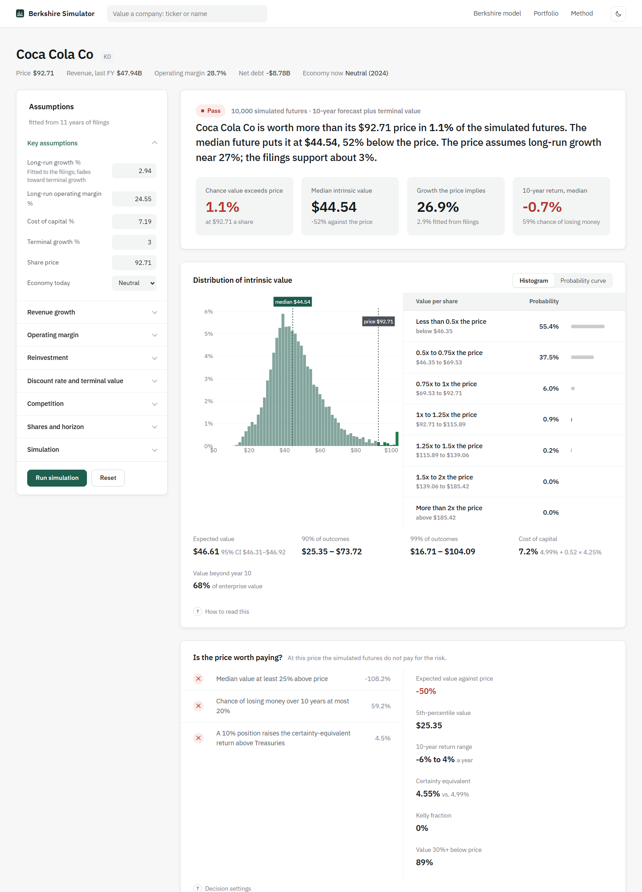
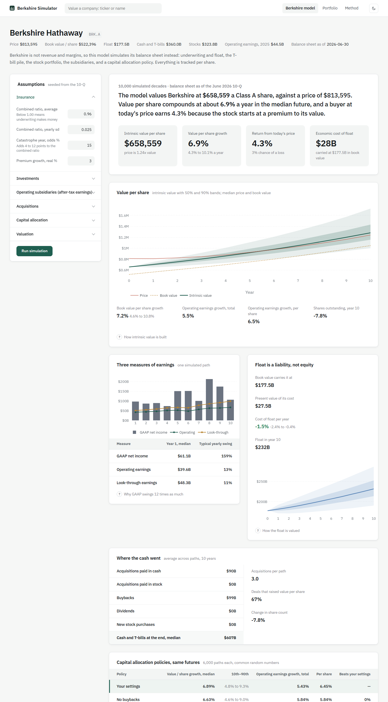
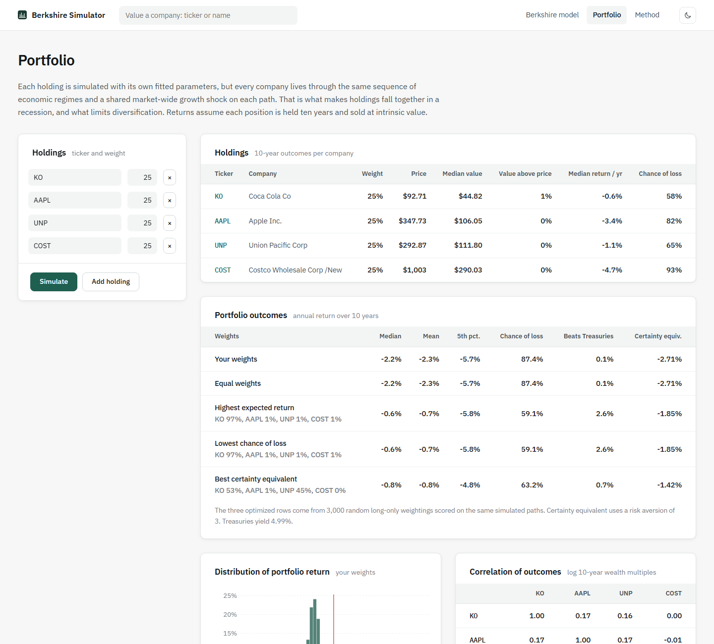

# Berkshire Simulator

Probabilistic company valuation fitted to SEC filings, plus a model of how Berkshire Hathaway compounds value per share.

A normal DCF gives one number and quietly assumes the analyst knows the future. This runs 10,000 futures instead. Each company's growth, margins and reinvestment are fitted to its own 10-K history and pushed through economic regimes estimated from U.S. data since 1961. The output is a distribution of intrinsic value, the probability that it beats today's price, and what drives the spread.

**Live:** https://berkshire-simulator.vercel.app

## Why I built this

The honest reason: I didn't take a heavy math course in high school. My highest was Algebra II. I got a 4.0 in it, but that doesn't show much math on paper, and getting a job in finance means proving you can handle the quantitative side. So I built a project where the math is the substance: Bayesian regression, Markov chains, fat-tailed and correlated distributions, Monte Carlo simulation and expected-utility decisions. I had to learn most of it as I went, and I wanted to show that I can apply it, not just list it.



## What it does

**Company valuation** (any U.S. filer with XBRL financials)
- Fits revenue growth and operating margin to up to twelve years of 10-K data with Bayesian regressions on GDP and inflation, so one odd year can't set a coefficient.
- Simulates correlated, fat-tailed (Student-t) growth and margin shocks. Margins revert toward their long-run level, and growth fades toward the terminal rate.
- Growth has to be paid for. Reinvestment is revenue added divided by the company's sales-to-capital ratio.
- Competitive shocks arrive as hazards: mild, significant or disruptive. A disruptive one pushes the return on new capital down to the cost of capital.
- Five economic regimes (expansion, neutral, high inflation, recession, severe crisis) follow a Markov chain fitted to 1961–2024. An inflationary regime raises the discount rate.
- Reports the probability that value exceeds the price, expected value with its confidence interval, outcome ranges, the 5th percentile, and the growth the market price implies (a reverse DCF).
- Decision layer: margin of safety, the chance of losing money over ten years, the certainty-equivalent return under CRRA utility, and a Kelly fraction computed from the simulated outcomes.
- Sensitivity two ways: a tornado chart with common random numbers, and a standardized rank regression for each driver's share of the variance.
- Scenario tree, revenue and margin fan charts, and a Bayesian update of long-run growth from the latest quarter.

**Berkshire Hathaway model**



- Simulates the balance sheet, not revenue and margins: underwriting results, float, interest on the T-bill pile, a stock portfolio that moves with the market regime, and BNSF, BHE and the manufacturing, service and retailing group.
- Float is a liability, never equity. Book value carries it at face. Intrinsic value carries it at the present value of what it will cost, which is far below face when underwriting is profitable and climbs toward face as underwriting worsens.
- GAAP net income, operating earnings and look-through earnings from the same path. GAAP swings roughly ten times as much because it includes unrealized gains.
- A capital allocation policy each year: keep a cash reserve, take acquisitions as they come (paid in cash or stock), and buy back stock only below intrinsic value.
- Compares policies on the same futures. Paying for acquisitions in stock raises total operating earnings and lowers them per share.
- A worked single-deal example showing why a stock deal can add earnings while destroying value per share when Berkshire's shares trade below their value.

**Portfolio.** Several holdings simulated through the same economic paths with a shared market shock. This produces their correlation, the distribution of portfolio returns, and the best weightings for expected return, chance of loss and certainty equivalent.



Light and dark themes, following the system setting until you pick one.

## Data

| Source | Used for |
| --- | --- |
| SEC EDGAR company facts and submissions | Annual and quarterly financials, share counts, SIC codes |
| Berkshire 10-Q (June 30, 2026) and earnings releases | Seed balance sheet, float and segment earnings ([data/berkshire.json](data/berkshire.json)) |
| World Bank | U.S. real GDP growth and CPI inflation, 1961 onward |
| FRED (TB3MS) | 3-month T-bill yields by year |
| Yahoo Finance | Share prices, the 10-year Treasury yield, betas, S&P 500 history |

Everything is free. The regime data is built once by [scripts/build_macro.py](scripts/build_macro.py) and committed to [data/macro.json](data/macro.json).

## How it works

The fitting and simulation are explained on the app's Method page, with the equations and the regime tables. The main choices and the reasons for them are in [docs/DECISIONS.md](docs/DECISIONS.md). In brief:

```
log growth_t  = a + b·GDPgap_t + c·CPIgap_t + e_t             (Bayesian regression, weak priors)
Δmargin_t     = −κ·(margin_t−1 − m̄) + d·GDPgap_t + f·CPIgap_t + u_t
(e, u)        ~ bivariate Student-t, correlation ρ, part of e shared market-wide
FCFF_t        = revenue_t·margin_t·(1 − tax) − Δrevenue_t / sales-to-capital
TV            = NOPAT_T+1·(1 − g / RONIC) / (WACC − g)
```

## Running it

```bash
pip install -r requirements.txt -r requirements-dev.txt
SEC_USER_AGENT="Your Name you@example.com" uvicorn api.index:app --port 8500
```

Open http://localhost:8500. The SEC asks automated clients to identify themselves, so set `SEC_USER_AGENT` to your name and email.

```bash
python -m pytest
```

## Project layout

```
sim/            fitting, the Monte Carlo engine, analysis, Berkshire model, portfolio, API
api/index.py    entry point for Vercel and uvicorn
public/         plain JavaScript front end, no build step; charts with Plotly
data/           regime history and the Berkshire seed figures
scripts/        rebuilds data/macro.json
tests/          engine, fitting, regimes and Berkshire tests
```

## Limitations

- At a 5% Treasury yield and a 4.25% equity risk premium, most quality companies simulate below their market price. That is a real result of the inputs, not a bug. The "growth the price implies" line shows what the market is assuming instead.
- The model doesn't suit banks and insurers, since revenue and margins don't describe them. The app warns when a company's SIC code is financial.
- Working capital is left out of reinvestment because too few companies tag it consistently.
- The Berkshire model's multiples, retention rates and returns on retained earnings are judgments, not filings. They are all editable.
- Twelve years of annual data is a small sample. The priors are there because of it, and the app shows the least-squares estimates next to the posteriors.

Not investment advice. Not affiliated with Berkshire Hathaway Inc.

Contact: noah.w.williams@protonmail.com
